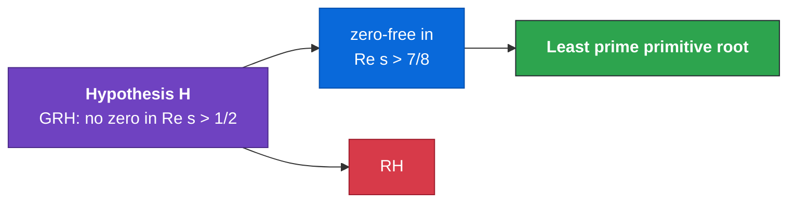

<div align="center">

# 🌱 primitive-root-grh

### Vinogradov's least prime primitive root conjecture under GRH

[](lean-toolchain)
[](lake-manifest.json)
[](axioms.txt)
[-d73a49)](LiouvilleEnergyRH/Hypothesis.lean)
[](Axioms.lean)
[](PrimitiveRoot.lean)
[](https://github.com/anaxia-research/liouville-energy-rh)

</div>

---

> **Paper.** D. Bhattacharjee and U. Bhattacharya, *The Riemann Hypothesis and Its Generalization as One Energy Bound*, preprint, 2026.
>
> **Parent repository.** [anaxia-research/liouville-energy-rh](https://github.com/anaxia-research/liouville-energy-rh), the full Lean formalization of the paper.



🟣 **Parent conjecture:** the generalized Riemann hypothesis (GRH) for Dirichlet L-functions, in the form of Hypothesis H: no Dirichlet L-function vanishes in Re s > 1/2. Hypothesis H also gives the Riemann hypothesis (`LiouvilleEnergyRH.riemannHypothesis_of_H`).

🎯 **Statement.** For every ε > 0 there is C such that every prime p has a prime primitive root ℓ ≤ C p^ε (Vinogradov's conjecture). Every prime p ≥ p₀ has a prime primitive root ℓ < p (Erdős Problem 985 for large p).

✅ **Lean 4 declarations** (each takes Hypothesis H as an explicit hypothesis):

- `LiouvilleEnergyRH.least_prime_primitive_root`
- `LiouvilleEnergyRH.erdos_985`

`lake env lean Axioms.lean` prints only `propext`, `Classical.choice` and `Quot.sound` for each (see `axioms.txt`). There is no `sorry`, `axiom` or `native_decide` in the sources.

## 🔧 Build

```
lake exe cache get
lake build
lake env lean Axioms.lean
```

Lean v4.34.1, Mathlib v4.34.1.

## 🙏 Context and credit

This is one corollary of the paper *The Riemann Hypothesis and Its Generalization as One Energy Bound* by D. Bhattacharjee and U. Bhattacharya. The full formalization, with all the corollaries, is at [anaxia-research/liouville-energy-rh](https://github.com/anaxia-research/liouville-energy-rh). Hypothesis H is stated word for word as `DirichletLNonvanishingRightOfHalf` in L. Alpöge's Lean project (alpo.ge, November 2026). Third-party sources are listed in [`NOTICE`](NOTICE): the library `Vinogradov/` (creelie/breakthrough-problems-3, Apache 2.0), OpenAI's `LogarithmicControl.lean` (Apache 2.0), and the Selberg sieve from PrimeNumberTheoremAnd (Apache 2.0).

## 📖 Citation

```bibtex
@misc{BhattacharjeeBhattacharya2026,
  author = {Bhattacharjee, Deep and Bhattacharya, U.},
  title  = {The Riemann Hypothesis and Its Generalization as One Energy Bound},
  year   = {2026},
  note   = {Preprint. Lean formalization: https://github.com/anaxia-research/liouville-energy-rh}
}
```
